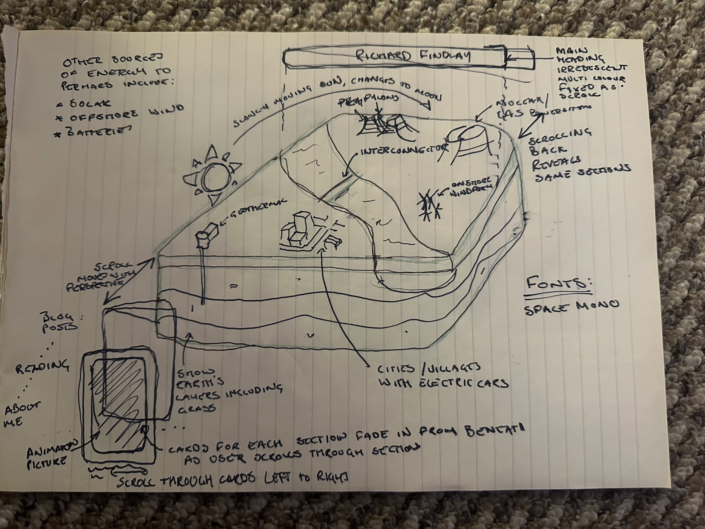

*Richard's sketch: the vision this brief describes. Also published as its own artefact.*

# richardfindlay.co.uk front-end redesign: agent brief

Owner: Richard Findlay. Repo: `RichardFindlay/personal-website` (Django). Hosted on Railway. Branch: `feature/isometric-home` off `main`. Nothing merges to `main` until Richard signs off.

## 1. Goal

Replace the homepage with a single scrolling page built around one large, playful, highly detailed isometric island of the GB power system, drawn in the same generated-SVG style as the existing blog card scenes. Scrolling moves the camera along the isometric axis; the site's sections rise into view as glass cards in front of and behind the island; a sun arcs over the island and becomes a moon as the user scrolls, and the island's night-time generation lights up. Typography is Space Mono.

This is a distinctive, intentional piece of design, not a template. Every choice should read as deliberate. The sketch Richard supplied (`docs/redesign-sketch.jpg`) is rough but the vision is not.

## 2. Non-negotiables

- Work on `feature/isometric-home`. Never commit to `main`. Never deploy to the production Railway environment; use a preview environment for the branch (see section 10).
- Do not modify the existing blog post pages (`templates/posts/*`, `post_detail.html`) or their routes. They keep their current look.
- Do not regenerate or alter the existing card scenes in `staticfiles/image/thumbnails/*` (`ohmera`, `wake`, `cyclone`, `battery`). Their animations are kept as they are and reused on the new homepage. If an import path has to change in `figures/*/build.mjs` (section 8.2), the rebuilt output must be byte-identical to what is committed; verify with `git diff --stat`.
- Keep all existing outbound links, post URLs, social links, sitemap and robots.txt working.
- Space Mono everywhere on the new homepage. Wherever the letter O appears in display text on the homepage (headings, section labels, nav, card titles, button labels), set it as the digit `0` so Space Mono's dotted zero shows. Body copy (paragraphs of the About section, post excerpts) keeps normal O.
- British English in all copy and comments. No em dashes.

## 3. Design guideline

**Style.** Surrealist, detailed, isometric. Glassmorphism for the UI layer: frosted panels (`backdrop-filter: blur`), thin 1px translucent borders, soft inner highlight, generous radius. The island is the hero; the UI floats over it and never competes with it. Think toy-like precision, not cartoon.

**Reference for drawing style.** Read `figures/ohmera/build.mjs`, `figures/wake/build.mjs` and `figures/cyclone/build.mjs` before drawing anything. Match their conventions: banded tonal shading (`BANDS`), `solidSvg`/`lineSvg` with `tone` classes, `var(--anatomy-*)` colour variables, seeded randomness, scoped CSS class prefixes, a `build.mjs` that writes both the SVG and its animation JS. The island must look like it belongs to the same family as those cards.

**Palette.** The island keeps the existing daylight palette family from the `-colour` scenes (`--anatomy-*` daylight values in `figures/ohmera/build.mjs`). The page itself is pure white (`#ffffff`) in light mode and pure black (`#000000`) in dark mode, not navy. Glass cards tint from the page colour. Accent colours come from the island, not from an additional brand palette.

**Heading.** `RICHARD FINDLAY` in Space Mono, uppercase, fixed at the top while scrolling. Iridescent multi-colour fill (animated gradient via `background-clip: text`), slow and subtle, shifting over roughly 12 to 20 seconds. It should shimmer like oil on water, not cycle like RGB lighting. Below or beside it, the existing tagline `Energy | Climate Change | Artificial Intelligence` in muted mono, small.

**Section labels.** Uppercase Space Mono with the zero substitution: `BL0G P0STS`, `READING / MEDIA`, `AB0UT ME`, `0THER PR0JECTS`. Letter-spaced, small, like a map legend.

**Motion principles.** Everything moves with the scroll or at a slow idle. No bounce, no spring overshoot on cards. Fades and rises use `cubic-bezier(0.22, 1, 0.36, 1)` over 500 to 700 ms. The island's idle animations (turbines turning, EVs driving, interconnector pulsing, sea moving) run continuously at low intensity. Honour `prefers-reduced-motion`: static island, no camera dolly, no smooth scroll, cards simply appear.

## 4. Page structure (homepage only)

    [fixed]  RICHARD FINDLAY  (iridescent)      nav: BL0G P0STS · READING/MEDIA · AB0UT ME · 0THER PR0JECTS · socials · theme toggle
    [fixed]  island canvas, full viewport, camera driven by scroll progress
    [flow]   hero spacer (island fully visible, tagline, scroll cue)
    [flow]   section 1  BL0G P0STS       cards in a horizontal row: ohmera.ai card + 3 post cards, existing scene animations
    [flow]   section 2  READING / MEDIA   horizontal strip of book covers from the current reading list
    [flow]   section 3  AB0UT ME          bio, education, online courses, awards, folded from about.html
    [flow]   section 4  0THER PR0JECTS    donder, officetea (and room for more)
    [flow]   footer                       name, socials

The `/about` and `/reading` routes should redirect (301) to `/#about` and `/#reading` once the sections are live, so existing links still land somewhere sensible.

### Sections live in the island's space

This is the core idea and the thing most likely to be built wrong, so read it twice.

- The sections are not a flat UI layer on top of the island. Each section's label and cards are placed **in the island's isometric space**, skewed to the same plane as the island's near edge (see the phone-shaped frame at the island's bottom-left corner in the sketch). Use a CSS 3D transform on each section's container that matches the island's isometric angles exactly, so a card's edges run parallel to the island's edges. Derive the transform from the same projection constants the island build uses; do not eyeball it.
- The camera travels along the isometric axis that runs from the island's near corner towards the viewer (the "scroll moves with perspective" arrow in the sketch). At the hero the island sits ahead of the viewer. As the user scrolls, the island comes towards the viewer and slides past the near corner of the frame; the sections are laid out along that same axis beyond the island, so they come into view as the island clears, `BL0G P0STS` first. "Behind the island" means further along the scroll direction, not the far side of the landmass. The island never leaves the frame entirely: its near corner and the earth cross-section stay in view as a receding backdrop while the sections are in focus, so a card can sit partly behind a foreground feature.
- The hero shows the island alone; no section is visible until the user starts scrolling, and the first section only begins to appear once the island has visibly moved towards the viewer (roughly the first 15 to 20% of scroll is the island's approach).
- As the scroll approaches a section, its label (`BL0G P0STS` etc.) fades in first, then its cards fade in and rise from beneath along the isometric vertical (translate along the island's up axis, roughly 40px to 0, opacity 0 to 1), staggered 60 to 90 ms per card. The magnetic snap (section 6) settles the camera with the section centred.
- Depth fade: the current section is at full opacity. Neighbouring sections are visible but faded (around 25 to 35% opacity, slightly smaller by distance along the edge), so from `BL0G P0STS` the user can already see `READING / MEDIA` waiting further along. Sections two or more stops away are hidden. The island itself dims slightly (around 10%) in the region not currently in focus.
- Scrolling back up reverses all of this exactly; nothing is one-shot.
- Cards within a section scroll horizontally, left to right, with scroll snapping per card. Wheel and trackpad gestures over a focused row move it horizontally; touch drag on mobile. The row stays in the isometric plane while it moves.
- Where a card sits next to a foreground island feature (a hill, the cooling towers, a pylon), the feature may clip the card's edge so the card reads as part of the scene. That overlap must never hide a card's title or link target; test at every breakpoint.
- Text inside the skewed cards must stay legible: keep the skew angle true to the island but increase font size and contrast if needed, and let the card's inner content un-skew on hover or focus so links and copy can be read square-on.
- Blog cards: reuse the existing `.card-scene` fetch-and-animate mechanism from `index.html` and the existing `-colour` scenes. The ohmera.ai card moves into this section.
- Reading strip: use the existing cover images in `staticfiles/image/books/` and the existing Amazon links from `reading_list.html`. Covers stand upright as glass-framed tiles; a subtle shadow on the island's ground plane is a nice touch, not required.
- About: content from `about.html` (bio paragraph, education, online courses, awards and accolades) split across two or three glass cards. Keep the profile image.

## 5. The island

A single generated scene, built by a new `figures/island/build.mjs` writing `staticfiles/image/island/island.svg` and `island.js`, with a `preview.html` beside the build as the other figures have. True isometric projection (not the perspective camera the cards use). One unit is one metre; size the island so the full thing fits a 1440 x 900 viewport at hero with margin.

Must include, drawn with care and some wit:

- Landmass with coastline and sea; the sea animates gently.
- Cross-section on the near faces: grass, topsoil, then rock strata, with a geothermal bore descending through the layers to a plant on the surface.
- Transmission pylons and lines crossing the island; an interconnector cable leaving the coast into the sea.
- Nuclear station with cooling towers (plume animates), a gas plant with a stack.
- Onshore wind farm (rotors turn; reuse rotor logic from `figures/wake/rotor.mjs` only if it adapts cleanly to isometric, otherwise draw simpler iso rotors).
- Offshore wind off the coast, solar farm, a battery compound.
- Towns and villages with roads; electric cars move along the roads.
- A sun that travels an arc over the island from left to right as scroll progress goes 0 to 1, dipping at the far side and replaced by a moon rising on the near side for the final third.

**Night behaviour.** When night falls: town windows light up, car headlights come on, the gas plant and nuclear station show a warm glow at the stack and turbine hall, the cooling tower plume catches moonlight, the battery compound's indicator lights blink on, pylon aircraft-warning lights blink. Solar goes dark. Wind keeps turning. Night is driven by one `night` value from 0 to 1 that every light and glow reads from, so the transition is continuous, never a switch.

**What drives `night`.** In light mode, scroll: `night` rises from 0 to 1 across the final third of the page as the sun sets and the moon comes up. In dark mode, the island is at night for the whole page: `night` is 1 throughout, the moon replaces the sun and travels the same arc with scroll, and the sea and sky darken to match. Switching theme eases `night` between the two states over about 1.5 s rather than cutting.

**Performance budget.** `island.svg` at most 600 KB raw, 150 KB gzipped. Lazy-load it after first paint with a fade-in like the cards. Animation via `requestAnimationFrame`, paused when the tab is hidden or the island is off-screen. Target 60 fps on a mid-range laptop, no jank on scroll; profile in Chrome before declaring done.

## 6. Scroll and camera

- Smooth scrolling with Lenis, section timelines with GSAP ScrollTrigger (or an equivalent you can justify). Vendor the libraries into `staticfiles/js/vendor/` with pinned versions, no CDN.
- The island and the sections translate together along the screen projection of the isometric axis that points from the island's near corner towards the viewer, so everything slides diagonally towards the bottom-left of the frame as the user scrolls down, not straight up. The island approaches first, then the sections arrive along the same line behind it. Scroll progress 0 to 1 maps to the dolly, the section focus and the sun/moon arc (and, in light mode, to `night`). Scrolling back up reverses everything exactly.
- "Haptic" feel: gentle magnetic snapping towards each section's anchor when the scroll settles within about 15% of the viewport of it, with an eased pull of 600 to 800 ms. Never trap the user: a deliberate scroll past the anchor must escape without fighting.
- Nav links scroll smoothly to anchors through the same scroll instance.

## 7. Theme

- Light mode: white page, dark text, glass cards tinted white. Dark mode: black page, light text, glass cards tinted black. Follow `prefers-color-scheme` by default with a toggle in the fixed header; persist the choice in `localStorage`.
- Selecting dark mode puts the island into night (section 5): the island's material palette stays the same, but the lighting state follows the theme. Light mode returns it to the scroll-driven day-to-night cycle. Check the island's edge and sea read cleanly against both pure white and pure black; add a faint halo or vignette behind it if needed.

## 8. Technical plan

### 8.1 Stack

Keep Django and the existing views. Add a new `templates/home.html` for the redesigned page rather than editing `index.html` in place, and switch the `home` route to it in `blog/views.py` once it is ready, keeping `index.html` in the tree until merge. Bootstrap stays for the post pages; the new homepage should not depend on Bootstrap's CSS for layout (use CSS grid/flex and custom properties) but may still load it through `base.html` if that is simpler. Space Mono from Google Fonts with `font-display: swap`, or self-host in `staticfiles/fonts/`.

### 8.2 The `anatomy` skill

All `figures/*/build.mjs` import the drawing kit from `~/.claude/skills/anatomy/kit/`. This is a Claude Code skill in Richard's account, not part of the repo.

First task of the session: check whether `~/.claude/skills/anatomy/kit/iso-kit.mjs` exists in your environment. If it does not, stop and tell Richard before doing anything else; the island cannot be built without it. If it does, vendor the `kit/` directory into `figures/lib/anatomy/kit/` and change the imports in every `figures/*/build.mjs` to resolve the vendored copy first, falling back to the home path. Then run each existing build and confirm its outputs are byte-identical to the committed files. Commit the vendored kit separately with a message explaining why.

### 8.3 Build and run

- `node figures/island/build.mjs` builds the island; `--check` flag (add it) renders `preview.html` to a PNG with Playwright for review.
- Run the Django dev server locally for screenshots: `python manage.py runserver`.
- Add `scripts/screenshots.mjs` (Playwright): loads the homepage, captures 1440 x 900 and 390 x 844, light and dark, at scroll progress 0, 0.25, 0.5, 0.75, 1.0, plus one frame of each section's horizontal row scrolled halfway. Writes to `review/<milestone>/<viewport>-<theme>-<progress>.png`. Commit the `review/` folder on this branch so the screenshots live with the code they show.

## 9. Mobile

Scale the whole island down to fit the viewport width with the island's most detailed region centred; do not crop. Sections stack with full-width cards; horizontal rows become touch-scroll carousels with visible peek of the next card. The fixed header collapses to the name and a compact menu. Test at 390 x 844 and 768 x 1024 as well as desktop.

## 10. Workflow and review

You have GitHub and Railway connected through connectors. Use GitHub for the branch, pushes and the final PR; use the Railway connector for the preview environment and for reading deploy logs if a build fails. Never change production service settings, variables or domains.

Work in milestones. At the end of each, run `scripts/screenshots.mjs`, commit, push, and post a short message to Richard with the screenshots and any decisions you made. Wait for his reply before starting the next milestone unless he has said to continue.

- M0: branch, skill check, vendoring, byte-identical rebuild check, Lenis/GSAP vendored, empty `home.html` with fixed header and theme toggle rendering.
- M1: static island at hero, day palette, in `preview.html` and on the page. Screenshots.
- M2: scroll camera dolly (island approaching and passing the viewer), sun to moon arc, night lights. Screenshots at five scroll positions, plus a short screen recording or GIF of the full scroll so Richard can judge the motion, not just the frames.
- M3: four sections in the island's isometric plane, horizontal rows, label-then-cards fade-in, depth fade between neighbours, snapping. Include a screenshot with the island hidden to prove the card transforms match its angles.
- M4: dark mode, reduced-motion, mobile, performance profiling, `/about` and `/reading` redirects.
- M5: Railway preview environment for the branch (use the Railway tools; create or use a non-production environment, never touch production), final screenshot set, PR against `main` with the review screenshots embedded in the description. Do not merge.

Commit small and often with descriptive messages. If something in this brief conflicts with what you find in the repo, say so in your check-in rather than silently choosing.

## 11. Acceptance criteria

- Homepage renders the island and all four sections on desktop and mobile, light and dark.
- Existing post URLs, ohmera.ai, donder, officetea, reading list book links and social links all work. `/about` and `/reading` redirect to their sections.
- Existing card scenes animate exactly as before on the blog cards; their files are unchanged.
- Scroll forwards and backwards is smooth and reversible; snapping never traps the user.
- Section cards sit in the island's isometric plane with edges parallel to the island's edges; the focused section is at full opacity, its neighbours faintly visible, the rest hidden.
- In light mode the sun/moon and night lights track scroll progress continuously; in dark mode the island is at night throughout and theme switches ease rather than cut.
- `prefers-reduced-motion` gives a static, fully readable page.
- Lighthouse performance on the homepage is at least 85 on desktop; no layout shift from the island loading.
- Every O in homepage display text is a `0`; body copy is untouched.
- No regressions on blog post pages (compare screenshots before and after).

## 12. Decisions for Richard to confirm in the first check-in

1.  Nav: keep a slim fixed nav with the four section labels, or heading only with the sections discoverable by scroll?
2.  Hero: does the island fill the first viewport alone, or should the first blog card already be peeking in at the bottom as a scroll cue?
3.  About section: one long card or three (bio, education and courses, awards)?
4.  Reading strip: covers only, or a one-line note per book on hover?
